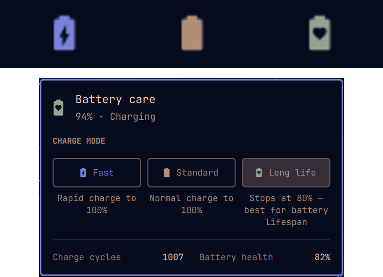

# Lenovo Battery Care

An Omarchy bar widget and service that picks Lenovo battery charge modes (Fast, Standard, Long life) and shows the active mode in its bar icon.



## What it does

- The bar glyph follows the active charge mode: Fast `󰂄` in the theme accent, Standard `󰁹` dimmed, Long life `󱈑` (battery + heart) in the theme's green. The glyph table is `BatteryModel.chargeModeIcon`; the green is read from the active theme's `colors.toml`.
- Left click opens the **Battery care** panel: the state line (`45% · Discharging`), the three charge-mode buttons with their hints, and charge cycles / battery health.
- Right click toggles Long life (the 80% cap) ⇄ Standard.
- It also carries the duties of Omarchy's built-in battery service: the low-battery notification at ≤ 10% while discharging (once per discharge, via `omarchy-battery-low`) and switching the power profile on AC changes (via `omarchy-powerprofiles-set battery|ac`).
- IPC target `pixeltux.battery` with `open`, `close` and `toggle`, e.g. for keybindings:

  ```sh
  omarchy-shell pixeltux.battery toggle
  ```

## Requirements

- Omarchy (the Quickshell shell). Plugin kinds: `service`, `bar-widget`.
- A Lenovo laptop with one of these charge-mode interfaces on its first `BAT*` battery (reading needs no privileges):
  - IdeaPad (`ideapad_acpi`): `charge_types` reporting `Fast [Standard] Long_Life`, where the bracketed entry is the active mode.
  - ThinkPad (`thinkpad_acpi`): `charge_control_start_threshold` / `charge_control_end_threshold`. Long life sets 75/80, Standard sets 95/100. There is no Fast mode, so the panel shows two buttons.
- `cycle_count`, `energy_full` and `energy_full_design` on that battery for the health numbers; the panel shows `—` when they are missing.
- A root helper for switching modes (installed below) plus passwordless sudo for it.
- A Nerd Font for the icons (Omarchy's default font resolves to a Nerd Font).

## Installation

Install the plugin:

```sh
omarchy plugin add https://github.com/PixelTux/omarchy-battery-care.git --enable
```

and, if it was not placed in the bar automatically:

```sh
omarchy bar put pixeltux.battery --section right
```

`omarchy plugin add` clones the repository's default branch (`main`), which carries the plugin at the repository root, so the clone is the whole plugin.

Install the root helper (the script shipped in `scripts/`, run from inside the cloned plugin directory):

```sh
sudo install -m 755 scripts/omarchy-battery-conservation /usr/local/bin/omarchy-battery-conservation
echo "$USER ALL=(root) NOPASSWD: /usr/local/bin/omarchy-battery-conservation" | sudo tee /etc/sudoers.d/omarchy-battery-conservation
sudo chmod 440 /etc/sudoers.d/omarchy-battery-conservation
sudo visudo -c
```

The plugin reads the sysfs files unprivileged and only calls the helper (`set-type`, via `sudo -n`) when a mode button is clicked.

Restart and check:

```sh
omarchy-restart-shell
omarchy plugin validate ~/.config/omarchy/plugins/pixeltux.battery
sudo -n /usr/local/bin/omarchy-battery-conservation get-type
```

`validate` prints nothing and exits 0; `get-type` prints `Fast`, `Standard` or `Long_Life`.

If the widget does not appear, or does not pick up local edits, run `omarchy-restart-shell`: plugin hot-reload logs fire, but on this Quickshell build the widget's QML is only recompiled by a shell restart.

## Repository layout

The plugin lives at the repository root of the default branch (`main`): `manifest.json`, `Service.qml`,
`BarWidget.qml`, `BatteryModel.js`, plus this README, the license, the preview image and the helper script
under `scripts/`. That is what `omarchy plugin add` clones, so the clone is the whole plugin: no build step,
no generated files.

## Usage

| Action | Result |
|---|---|
| Left click the bar icon | Opens the Battery care panel |
| Right click the bar icon | Toggles the 80% cap (Long life) ⇄ Standard |
| Panel mode buttons | Sets that charge mode (Fast / Standard / Long life) |
| Hover | Tooltip describing the active mode |

## Compatibility

Developed and tested on a **Lenovo 82TK — Yoga Slim 7 ProX 14IAH7**.

- Other Lenovo laptops that expose `charge_types` through `ideapad_acpi` — most recent IdeaPad, Yoga and Legion models — will likely work, but this plugin may need development to fit them. The two machine-specific pieces are the hardcoded `BAT1` path in `Service.qml` and the `VPC2004:00` node in the helper script.
- Models that only expose `conservation_mode` and no `charge_types` currently get no widget at all: the widget hides itself when that file cannot be read. Non-Lenovo machines are out of scope.

## Uninstall

```sh
omarchy plugin remove pixeltux.battery
sudo rm -f /usr/local/bin/omarchy-battery-conservation /etc/sudoers.d/omarchy-battery-conservation
```

## Credits

Cloned from Omarchy's built-in battery service (`manifest.json` → `omarchy.clonedFrom: "omarchy.battery"`); the charge-mode picker and the per-mode icons are additions. Icons are Material Design Icons, rendered through a Nerd Font.

## License

MIT — see [LICENSE](LICENSE).
